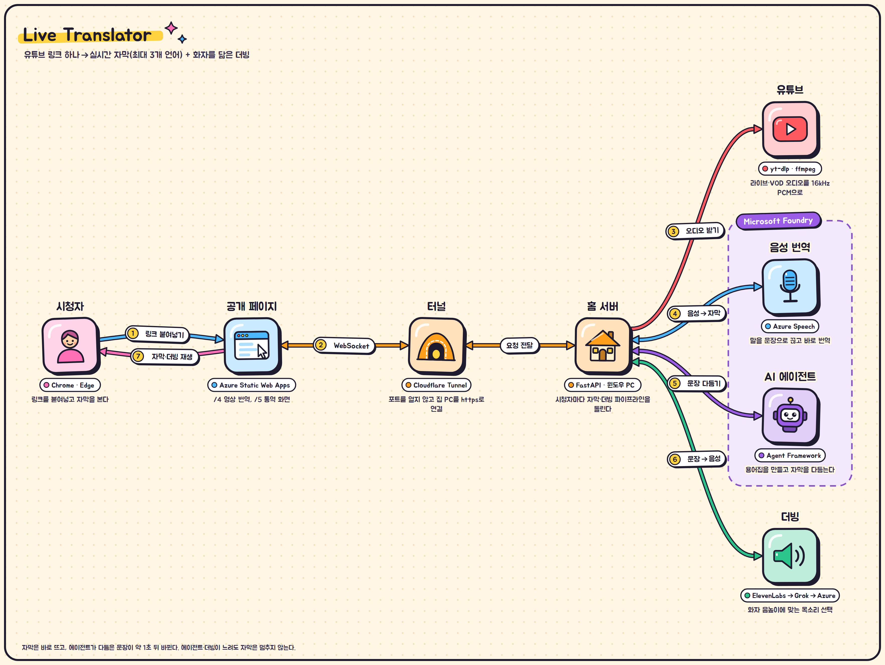
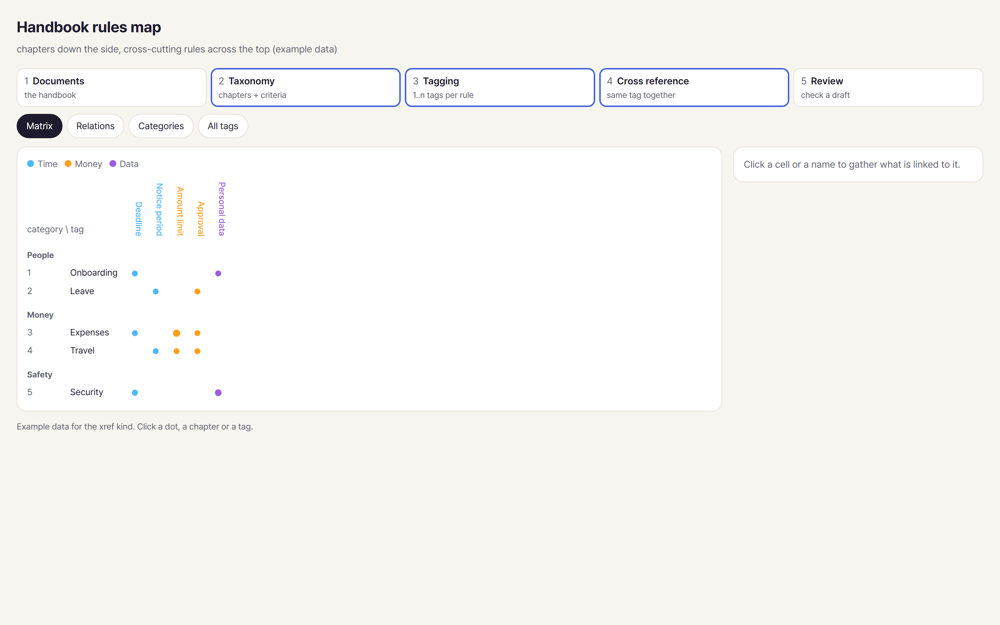
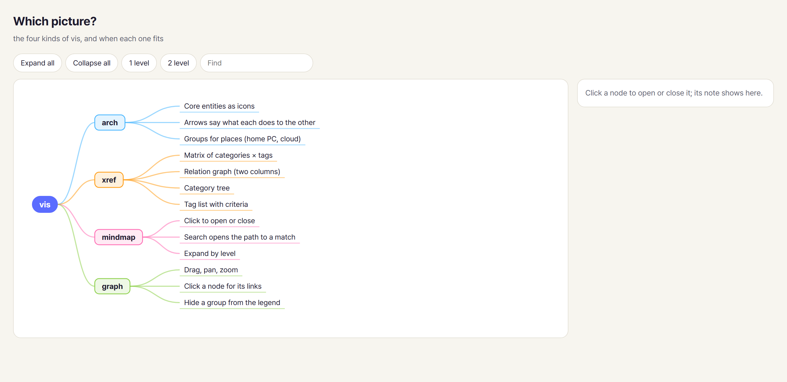
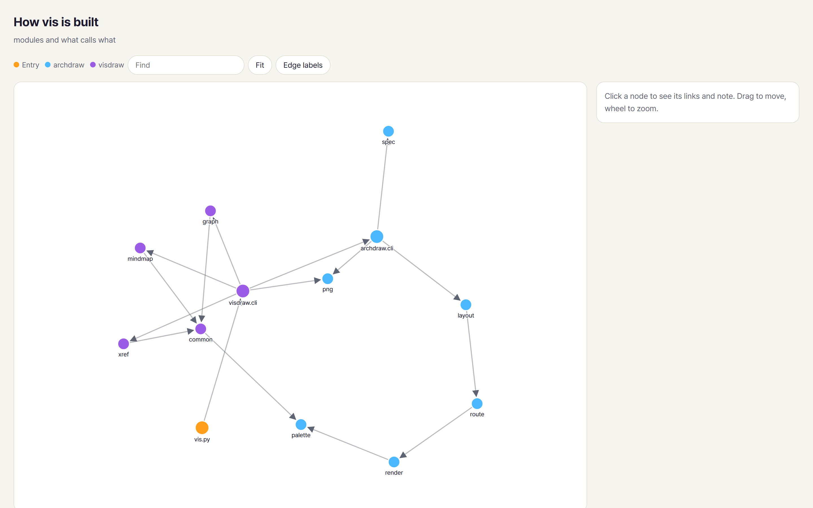

# vis

A Claude Code skill that turns a short YAML spec into a picture. One command, four kinds:

| kind | what | output |
|---|---|---|
| `arch` | colourful cartoon architecture diagram: core entities as icons, arrows that say what each does | HTML, SVG, PNG |
| `xref` | categories down the side x tags across the top: matrix, relation graph, category tree, tag list | HTML, PNG |
| `mindmap` | collapsible tree with notes and search | HTML, PNG |
| `graph` | force-laid network with drag, zoom, search and group filters | HTML, PNG |

Every HTML page is one self-contained file: no CDN, light and dark themes, phone width.



| | |
|---|---|
|  |  |
|  | |

## Use it in Claude Code

```text
/plugin marketplace add danielinjesus/vis
/plugin install vis@vis
/vis:vis draw this repo
```

Or just ask: "draw the architecture of this repo", "make a mind map of this outline", "map these rules by chapter
and tag". Claude writes the spec, renders it, looks at the PNG and fixes what overlaps.

## Use it by hand

```bash
pip install -r .claude/skills/vis/scripts/requirements.txt     # pyyaml, fonttools[woff]
python .claude/skills/vis/scripts/vis.py examples/translator.yaml
python .claude/skills/vis/scripts/vis.py examples/handbook.yaml
python .claude/skills/vis/scripts/vis.py --icons               # arch icons and their aliases
```

Every spec key, with one example per kind: [reference.md](.claude/skills/vis/reference.md).

The PNG is taken with headless Chrome, Edge or Chromium (found automatically; `VIS_BROWSER` overrides).

## How it works

| Path | What |
|---|---|
| `.claude/skills/vis/SKILL.md` | What Claude does: pick the kind, understand the material, write the spec, render, look, fix |
| `.claude/skills/vis/scripts/vis.py` | The command. Reads `kind:` and hands arch specs to archdraw |
| `.../visdraw/` | `xref`, `mindmap`, `graph`: spec checks in Python, the page drawn by inline JavaScript |
| `.../archdraw/` | `arch`: layout, routing, cartoon SVG, 40 hand-made icons, PNG via headless browser |

This repo was called `arch` until it learned the other three kinds.
